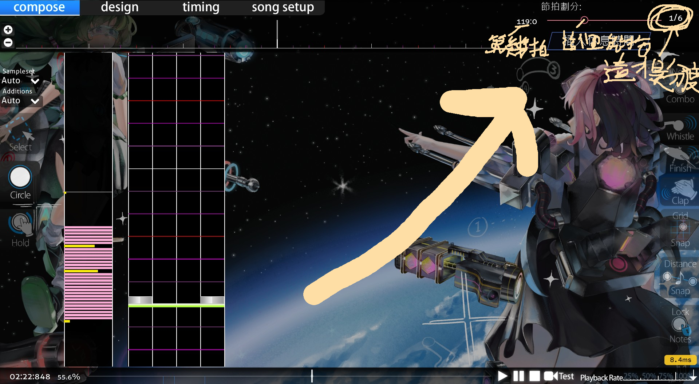
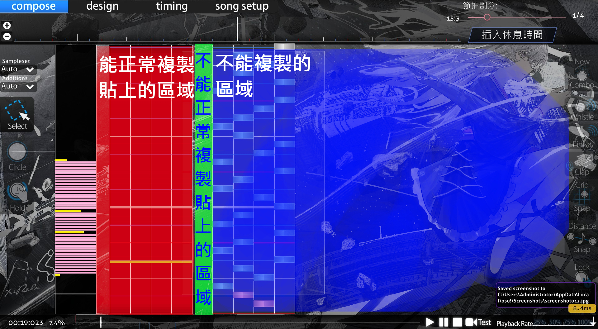
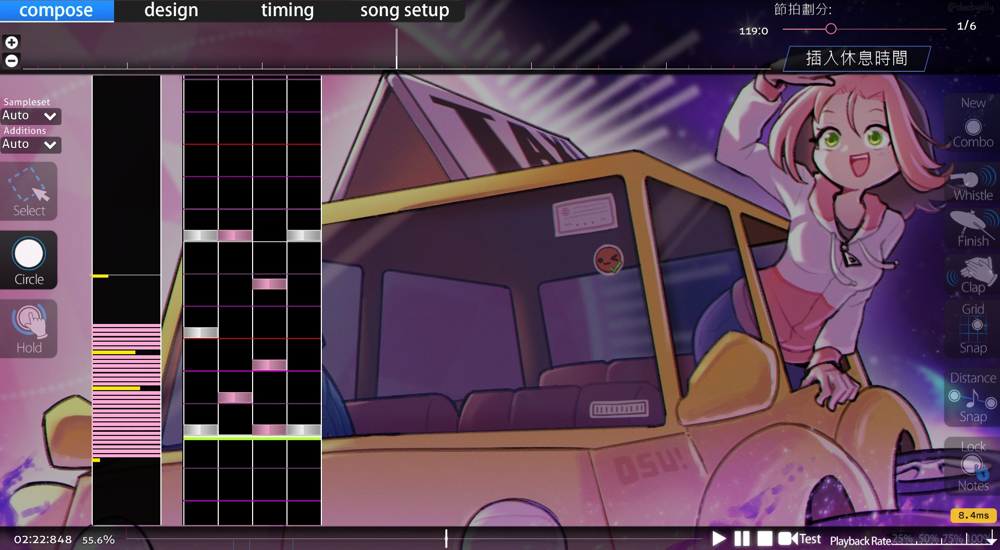
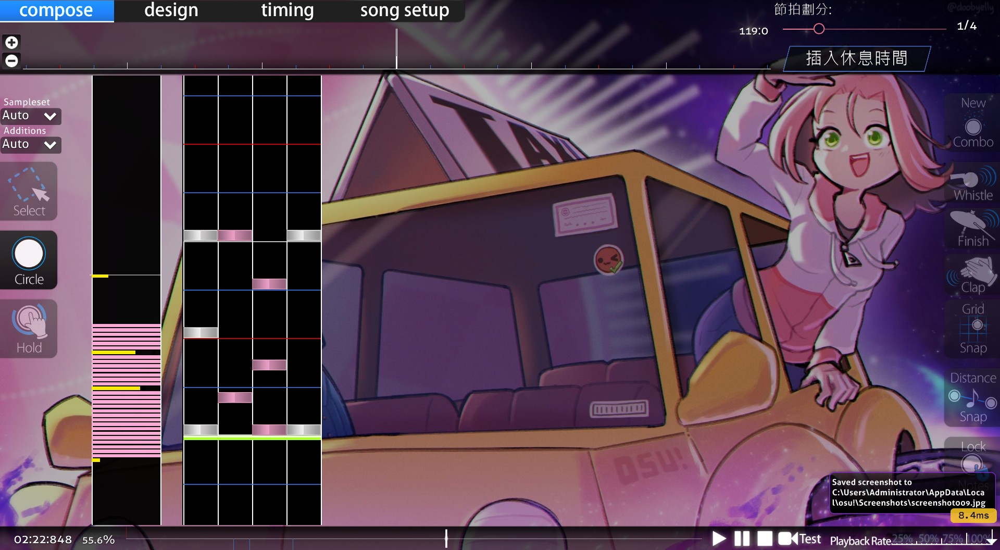
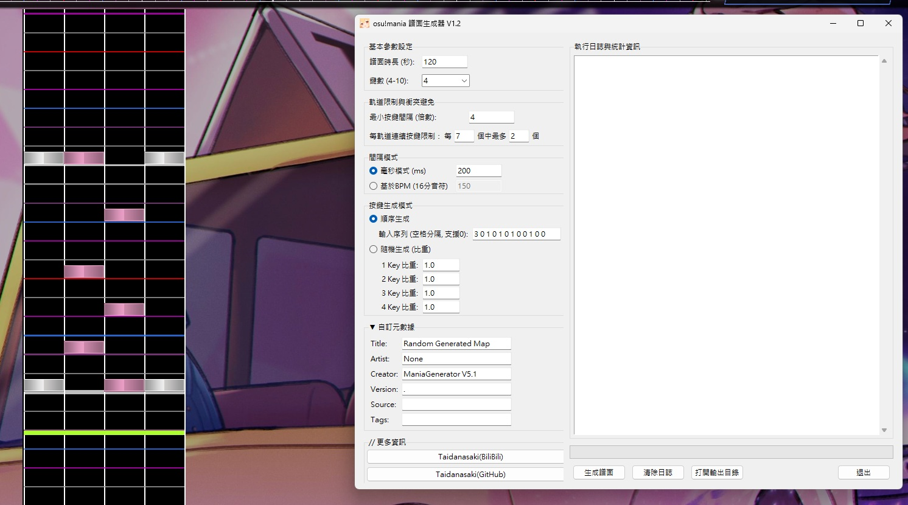

## It is recommended to use AI for the translation.
# 使用指南

# 前言

**這篇使用指南是針對譜師的**

首先，你要知道，這個程式的設計初衷是用來節省時間，以便我寫高難譜的時間花在不必要的排列上

所以，**它並不能代替你寫譜**，只能讓你節省排列重複排列的時間。

當然，你可以用來產練習譜，但我覺得應該沒人需要

# 準備工作

既然要寫譜，一個[osu](https://osu.ppy.sh/)肯定不能少的吧，我這裡非常推薦Stable版，因為Stable版的文件不像Lazer一樣分散的，它可以直接在遊戲目錄下的Songs資料夾中看到全部的譜面(一個譜面集一個資料夾ㄟ)，而不像Lazer一樣打亂、分散的放在files裡。

除此之外，你還要會做圖吧，推薦去Wiki看[osu基本的做圖流程](https://osu.ppy.sh/wiki/zh/Beatmapping)，或是其他人的教學，並且，**只有遇到重複的排列時，你才需要這個程式**

以下是一些你需要知道的東東

- osu 是用 .osu 作為副檔名的

- 你osu的位置

- 基礎的osu!mania術語

# 使用過程

好的，現在你遇到了要排列重複排列的情況了，那麼，你開始使用這個東西了

你需要填這些參數

- 鍵數
- 時長
- 最小按鍵間隔 (倍數)
- 每軌道連續按鍵限制
- BPM
- 生成序列

# 參數說明

## 鍵數

填你寫的鍵數就好

## 時長

填你要寫到的長度就好

## 軌道限制與衝突避免

### 最小按鍵間隔

間隔的倍數，不是毫秒，你用什麼就用什麼

### 每軌道連續按鍵限制

它是填每A個時間點中最多B個，而程式會向前檢查該軌道在過去A+B個時間點（包含當前的這一步)，只移動向前A個時間點

建議先在編輯器中擺放一下範本後再填

    如果要限制錨的長度，就填每 "X" 個中最多 "錨的長度" 個

X = 錨的長度 * 最小按鍵間隔 + 1到錨的長度中的數

錨縱類譜面可將A和B設為一樣的數

## BPM

填BPM，你要注意

- 歌曲的BPM
- 分度(節拍劃分)

### 歌曲的BPM

歌曲的BPM不用我多說了吧，只需要注意歌曲是否有變速就好(但請注意最終填的BPM會受到分度的影響)

### 分度(節拍劃分)

*即為劃分節拍的度量(Division of beat)*

分度這個很重要

你如果重複排列是不同的分度的話，那非常的麻煩，這裡先不討論了，因為太長了所以放到最後。

而分度就是你mapping時右上角的節拍劃分(圖一)

需要注意的是，1/4、1/6指的是1拍的1/4、1/6，而一拍在這裡因為我不想花更多時間解釋，所以就當4分音符吧

所以1/4表示16分音符，1/6表示24分音符，1/N表示4N分音符

你要用1/N來寫，為了讓程式的時間間隔與編輯器中的 1/N 分度對應，你就需要在BPM一欄填你原本的BPM乘上N/4(1/6的6就是N)

舉個例子

像是你的歌BPM是200，而你要用1/6來寫，那BPM一欄就填

200*6/4=300

這樣就能和編輯器中的分度對應了喵

## 按鍵生成模式

### 生成序列

BPM 和時長填完後就開始填生成序列了，生成序列就填重複排列的一節就好(以空格做分別)，**記得別把下一節的第一個填進去了**

### 隨機生成

祝你好運，這東西我都沒用過

# 生成譜面

好的，現在你已經將參數都填完了，你只需要按下***生成譜面***就可以了，生成完後可以在右邊看到資訊，也可以點擊打開輸出目錄來開啟輸出目錄

# 應用在譜面中

開啟你寫的譜，依序點開右上角的檔案->開啟歌曲資料夾，把生成的譜放在你要寫的歌曲資料夾裡。然後開啟譜面資料夾，點開右上角的檔案->開啟難度->參考，選擇生成的譜面的難度名(一般不修改的話是 .(20xxxxxd_xxxxxx) )，然後複製貼上(有限制，只能從左邊拉到右邊)

# 不同分度的處理方式
現在來教重複排列是不同的分度的話

首先，找公倍數，如16分和24分是48找到的公倍數作為你填BPM時的分度

然後把分度開到找到的公倍數，如果不止，就將BPM翻倍

照著每一條橫線填，空的也要填入

而按鍵間隔的話也要加上空的

# Extra

這個工具可以搭配其他的工具使用，這裡推薦幾個

## [DenseJack-Tool](https://github.com/inuiyumegan/DenseJack-Tool)
這個程式是將譜面轉換成疊，如1231->3213、2121-2323，這樣能彌補我這個工具生成的鍵型不夠的缺點
具體演示看[這裡](https://www.bilibili.com/video/BV11iRdBqEGf)(因為我說的不夠準確)

## [mania-inverse-generator](https://github.com/memo2138/mania-inverse-generator)
這個程式是用於將譜面轉換成反鍵
